<p align="center">
  <a href="https://umrah-aamani.pages.dev">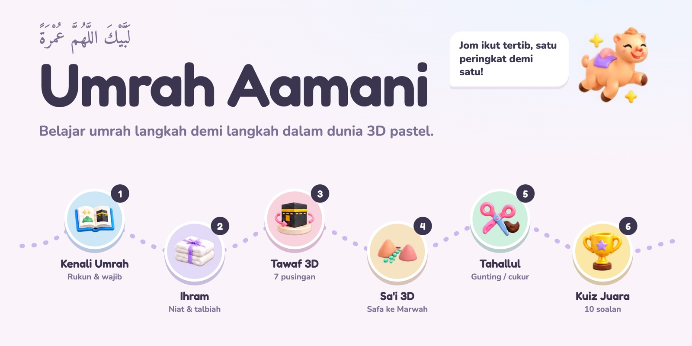</a>
</p>

<p align="center">
  <b><a href="https://umrah-aamani.pages.dev">Main di umrah-aamani.pages.dev</a></b><br>
  <sub>Percuma, tanpa daftar masuk. Boleh dipasang di telefon dan dimainkan tanpa internet.</sub>
</p>

<br>

Umrah Aamani ialah permainan rujukan umrah untuk seluruh keluarga. Pemain melalui setiap rukun mengikut tertib: berihram di miqat, bertawaf tujuh pusingan mengelilingi Kaabah dalam 3D, bersa'i dari Safa ke Marwah, kemudian bertahallul. Di setiap tempat, doanya muncul dalam tulisan Arab, rumi dan maksud.

<table>
  <tr>
    <td width="50%" align="center" valign="top">
      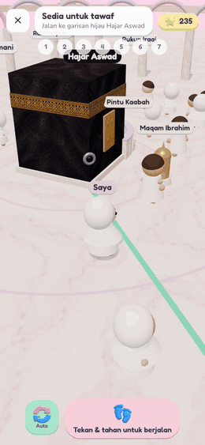<br>
      <sub><b>Tawaf 3D.</b> Kaabah sentiasa di sebelah kiri. Doa Rukun Yamani muncul bila anda lalu di situ.</sub>
    </td>
    <td width="50%" align="center" valign="top">
      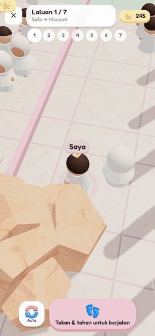<br>
      <sub><b>Sa'i 3D.</b> Tujuh laluan Safa–Marwah. Lelaki boleh berlari-lari anak antara dua lampu hijau.</sub>
    </td>
  </tr>
</table>

## Enam peringkat, ikut tertib

Setiap peringkat hanya dibuka selepas peringkat sebelumnya selesai, sama seperti tertib dalam umrah sebenar.

| | Peringkat | Apa yang pemain buat |
|:-:|---|---|
| 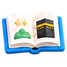 | **1. Kenali Umrah** | Baca kad tentang 5 rukun, 2 wajib dan miqat, kemudian jawab kuiz pendek. |
|  | **2. Ihram di Miqat** | Susun langkah persediaan ihram, lafaz niat dan talbiah, kemudian teka mana satu larangan ihram. |
| 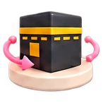 | **3. Tawaf 3D** | Berjalan tujuh pusingan dalam Masjidil Haram. Istilam di garisan Hajar Aswad, doa di Rukun Yamani. |
| 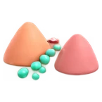 | **4. Sa'i 3D** | Mula dengan doa di atas Bukit Safa, kemudian tujuh laluan hingga tamat di Marwah. |
|  | **5. Tahallul** | Pilih bergunting atau bercukur (lelaki), kemudian potong sekurang-kurangnya tiga helai rambut. |
|  | **6. Kuiz Juara** | Sepuluh soalan rawak dari keseluruhan umrah. Skor penuh dapat lencana Juara Umrah. |

## Dalam permainan

<table>
  <tr>
    <td align="center" valign="top" width="25%">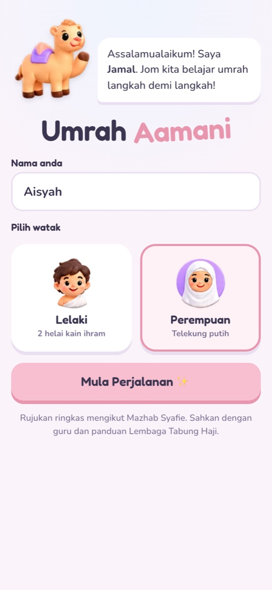<br><sub>Pilih watak lelaki (kain ihram) atau perempuan (telekung).</sub></td>
    <td align="center" valign="top" width="25%">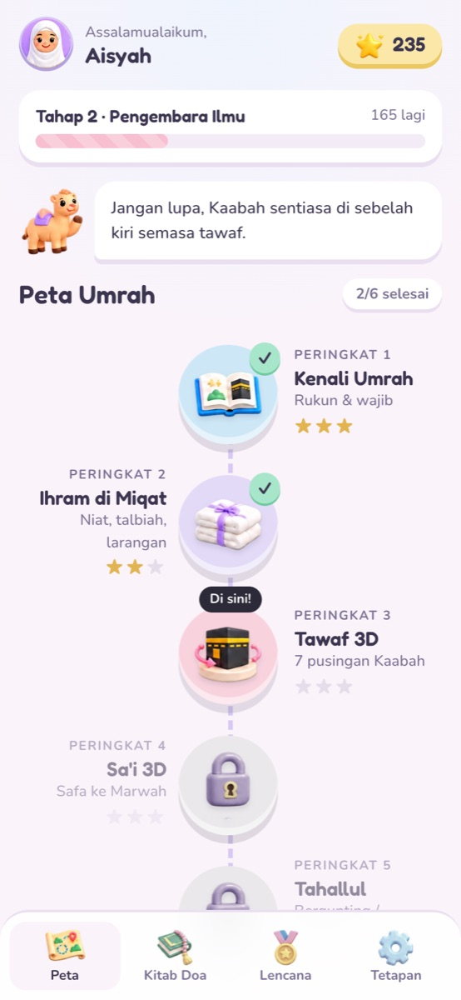<br><sub>Peta Umrah, mata dan tahap.</sub></td>
    <td align="center" valign="top" width="25%">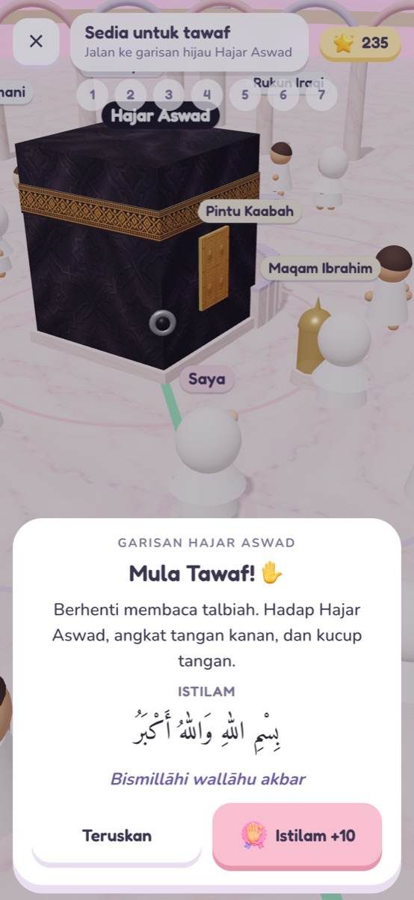<br><sub>Istilam di garisan Hajar Aswad.</sub></td>
    <td align="center" valign="top" width="25%">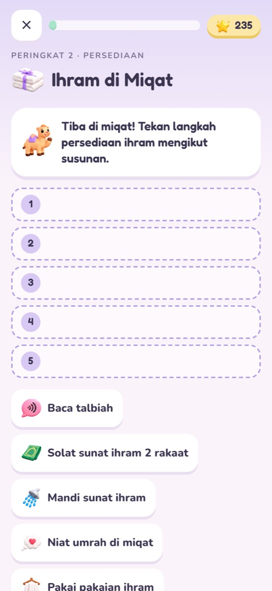<br><sub>Susun langkah ihram di miqat.</sub></td>
  </tr>
  <tr>
    <td align="center" valign="top">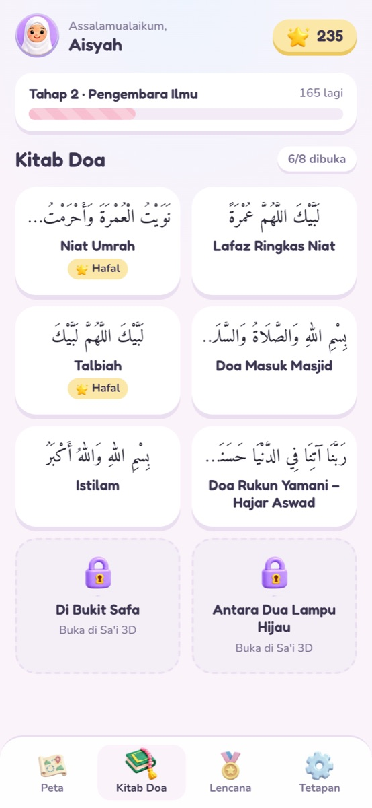<br><sub>Kitab Doa: 8 doa, tanda yang sudah dihafal.</sub></td>
    <td align="center" valign="top">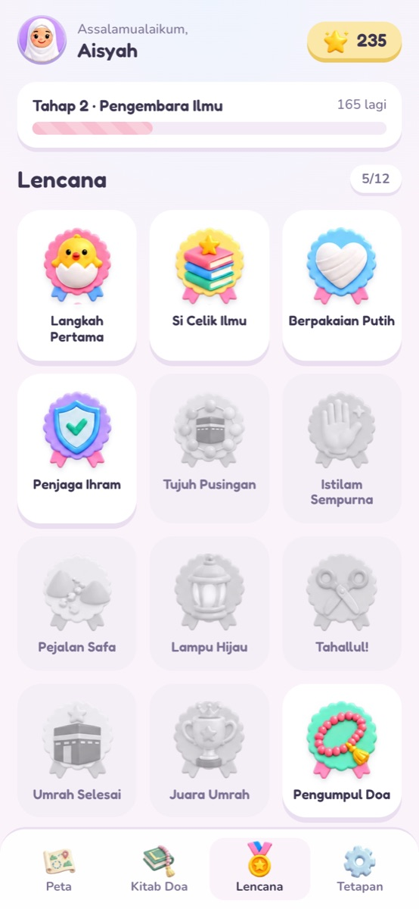<br><sub>12 lencana untuk dikumpul.</sub></td>
    <td align="center" valign="top">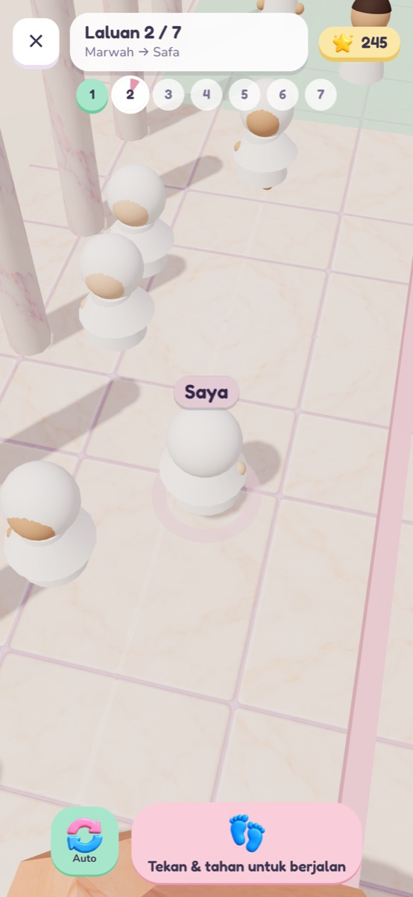<br><sub>Sa'i, laluan Marwah ke Safa.</sub></td>
    <td align="center" valign="top">
      <br>
      <sub><b>Jamal</b> si unta menemani sepanjang perjalanan dan berkongsi tip bila disentuh.</sub>
    </td>
  </tr>
</table>

### Mata, tahap dan lencana

- Setiap langkah yang betul memberi mata. Mata menaikkan tahap pemain dari **Musafir Kecil** hingga **Jemaah Cemerlang**.
- Peringkat diberi satu hingga tiga bintang. Ulang mana-mana peringkat untuk dapat bintang penuh.
- **Kitab Doa** menyimpan setiap doa yang telah dibuka (niat, talbiah, istilam, doa Safa dan lain-lain) dalam tulisan Arab, rumi dan maksud. Tanda "Sudah hafal" untuk mata tambahan.
- Kemajuan disimpan dalam pelayar pada peranti itu sahaja. Tiada akaun dan tiada data dihantar ke mana-mana.

## Jalankan sendiri

Ini laman statik biasa, jadi tiada langkah build dan tiada kebergantungan untuk dipasang. Fail perlu dibuka melalui pelayan web kerana modul ES tidak dimuatkan dari `file://`.

```sh
git clone https://github.com/mohdhaaziq/umrah-aamani.git
cd umrah-aamani
python3 -m http.server 8000
```

Kemudian buka <http://localhost:8000>.

Untuk deploy ke Cloudflare Pages:

```sh
npx wrangler pages deploy . --project-name umrah-aamani
```

Selepas mengubah fail yang dicache, naikkan `VERSION` dalam `sw.js` supaya pemain yang sudah memasang app menerima versi baharu.

## Susunan projek

```
index.html              Titik masuk, import map untuk three.js
css/style.css           Semua gaya UI dan token warna pastel
js/main.js              Skrin, navigasi, mata, lencana dan HUD 3D
js/content.js           Semua kandungan: doa, peringkat, kuiz, lencana, tahap
js/scene-tawaf.js       Babak 3D Masjidil Haram dan logik pusingan
js/scene-sai.js         Babak 3D Mas'a, Safa, Marwah dan lampu hijau
js/three-common.js      Pencahayaan, watak dan bahan yang dikongsi
js/audio.js             Bunyi disintesis dengan Web Audio (tiada fail audio)
vendor/                 three.js r170 dan OrbitControls
assets/icons/           Ikon 3D (WebP) untuk peringkat, lencana dan UI
assets/tex/             Tekstur kiswah, marmar, pintu Kaabah dan langit
sw.js                   Service worker untuk main tanpa internet
```

Untuk membetulkan atau menambah kandungan seperti doa, soalan kuiz atau larangan ihram, edit `js/content.js` sahaja.

## Tentang kandungan

Kandungan ialah rujukan ringkas mengikut **Mazhab Syafie**, bertujuan membantu keluarga dan kanak-kanak mengenal susunan umrah sebelum berangkat. Ia bukan pengganti kursus umrah. Sahkan setiap amalan dengan guru dan panduan rasmi Lembaga Tabung Haji.

Jumpa kesilapan pada doa, terjemahan atau hukum? Buka [isu](https://github.com/mohdhaaziq/umrah-aamani/issues) dan nyatakan rujukannya.
